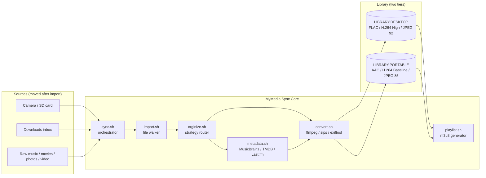

# MyMedia Sync

> A metadata-first pipeline that normalizes your personal media library into two
> parallel tiers — one for desktop/hi-fi, one for portable devices.
> Part of the **[mylibsystems](https://github.com/mylibsystems)** community.

<!-- Purpose -->


<!-- Technology -->


<!-- Media formats -->


<!-- Meta -->


**MyMedia Sync** is a set of bash scripts that automate importing, organizing, converting, and
backing up a personal media library. It ingests music, movies, TV, and photos from a camera, a
downloads inbox, and existing raw collections, then normalizes each file and files it into a clean,
tag-driven library on an external drive.

Every import produces **two parallel output trees**: a **desktop/hi-fi** tier (FLAC lossless,
full-resolution video, print-quality photos) and a **portable** tier (AAC M4A, 320×240 H.264, resized
JPEG) tuned for devices like the Sony Walkman NWZ-A720. Source files are **moved** (not copied) out of
the inbox after a successful import, leaving the source folder empty.

Metadata for every media type is fetched from authoritative internet databases (MusicBrainz, AcoustID,
TMDB, TheTVDB, Last.fm) and embedded into the output files. **Folder structure always reflects the
embedded metadata — never the original source folder names.**

---

## Why MyMedia Sync?

A media library is only as good as its structure. Most tools either transcode *or* organize;
MyMedia Sync does both, deterministically, for two device tiers at once:

- **Metadata-first.** Folder layout is derived from authoritative tags, not messy source folder names.
- **Two tiers, one pass.** Every file yields a desktop/hi-fi copy and a portable copy in a single run.
- **Tier parity.** The portable copy inherits the **same embedded metadata and cover art** as its desktop
  counterpart (title, year, genre, TV tags, artwork); only the long description is dropped and the cover
  art is downscaled for the device.
- **Preserve-first metadata.** Existing embedded tags and cover art are kept verbatim; the internet is
  consulted only to *fill in what's missing* and to *flag* suspicious mismatches — never to overwrite.
- **Idempotent & safe.** Every step checks for an existing output before acting; sources are removed
  only after both outputs are verified on disk. Re-running is always safe.
- **Configurable device targets.** All resolution, bitrate, and quality knobs live in `config.sh`,
  with documented Sony NWZ-A720 defaults you can override on the command line.
- **Parallel by default.** Per-folder imports run as capped background jobs across all CPU cores.

---

## What it does

| Capability | Description |
|------------|-------------|
| **Multi-source import** | Ingests from a camera SD card, a downloads inbox, and existing raw music/movie/photo/video collections. |
| **Dual-tier output** | Produces a desktop/hi-fi tree and a portable tree from every source file. |
| **Audio pipeline** | Desktop FLAC (lossless, original bit depth/rate) + portable AAC-LC M4A, with embedded tags and 500×500 cover art. |
| **Video pipeline** | Desktop H.264 High Profile (original resolution) + portable H.264 Baseline 320×240 for the Walkman. |
| **Photo pipeline** | Desktop print-quality JPEG (EXIF preserved) + portable 320 px JPEG with embedded thumbnail. |
| **Metadata enrichment** | Fills missing tags from MusicBrainz / AcoustID / TMDB / TheTVDB / Last.fm; preserves existing tags. |
| **Tag-driven organization** | Files into `Artist/Year - Album`, `Title (Year)`, `Series/S01E01`, or `YYYY/MM/DD` from embedded metadata. |
| **Playlists** | Generates per-album and per-artist `.m3u8` playlists for the music library. |
| **Backup & transfer** | Replicates the library structure to a backup destination (move or export/copy). |
| **Logging** | Per-run logs with rotation and archived full-run history under `logs/`. |

---

## Proposed architecture

MyMedia Sync is a modular pipeline so each stage can evolve independently — new sources, new device
targets, new metadata providers, or new output formats.



### Component breakdown

- **`sync.sh`** — Entry point / orchestrator. Sources `config.sh`, rotates logs, then runs the
  camera → downloads → music → movies → cleanup stages, using capped parallel background jobs.
- **`config.sh`** — Shared configuration: device target parameters, API keys, source/library roots,
  concurrency limits, and filename/length rules. Sourced by every other script.
- **`import.sh`** — Walks a source directory (`find -type f`, depth 8) and dispatches each file to
  `orginize.sh`, capturing worker output into the run log.
- **`orginize.sh`** — Per-file organizer. Routes by extension to a strategy (`orginizeByTags`,
  `orginizeByDate`, `orginizeByVideoMeta`, `orginizeDefault`), builds the tag-driven path, and
  moves the converted output into the correct library sub-tree.
- **`metadata.sh`** — Reads existing tags, then fills gaps from MusicBrainz/AcoustID (audio),
  TMDB/TheTVDB (video), and Cover Art Archive/Last.fm (art), with per-album caching.
- **`convert.sh`** — Transcodes to the desktop and portable formats via `ffmpeg`, `sips`, and
  `exiftool`, staging in a `.syncing` directory before the final move.
- **`playlist.sh`** — Builds per-album and per-artist `.m3u8` playlists with staleness checks.
- **`backup.sh` / `transfer.sh`** — Replicate the library structure to a backup destination,
  moving or (with `export`) copying, always non-destructively.
- **`clean.sh`** — Standalone RAW cleanup utility (removes paired/redundant RAW artifacts).

### Design principles

- **Metadata-first** — folder structure is always derived from authoritative tags, never source names.
- **Preserve-first** — existing tags and cover art are kept verbatim; the internet only fills gaps.
- **Idempotent & non-destructive** — outputs are skipped if present; `cp -n`/`mv -n` throughout.
- **Source destruction only on success** — a source is removed only after both outputs are verified.
- **Best-effort lookups** — metadata fetches time out (10 s default); a file is never blocked on one.
- **Configurable device targets** — every quality knob is a documented variable in `config.sh`.

---

## Current status

Two implementations live side by side:

- **`v1/`** — the original scripts (`sync`, `import`, `convert`, `transfer`, `backup`, `orginize`,
  `export`, `clean`).
- **`v2/`** — the current, hardened pipeline with shared `config.sh`, `metadata.sh`, `playlist.sh`,
  per-album metadata caching, log rotation/archival under `logs/`, and extensive real-library
  fixes (Unicode-safe naming, compilation/"Various Artists" grouping, tags-first layout, edition
  handling, filename length limits, and bash 3.2 crash-safe file walking).

See [SPECIFICATION.md](SPECIFICATION.md) for the full design reference.

> **Platform note:** MyMedia Sync is currently **macOS-only** — it relies on macOS-specific tools
> (`sips`, AudioToolbox) and `/Volumes/` mount paths. **Ubuntu / Linux support is planned for the
> v3 release.**

## Requirements

Runs on **macOS** (uses `sips` and `/Volumes/` paths). Requires:

| Tool | Purpose |
|------|---------|
| `ffmpeg` (with `libfdk_aac`, `libx264`) | Audio/video transcoding |
| `exiftool` | Read/write EXIF, XMP, IPTC metadata |
| `sips` | Native image conversion/resizing (built-in) |
| `AtomicParsley` | Embed metadata/cover art into MP4/M4A |
| `metaflac` (`flac`) | Embed metadata into FLAC |
| `eyeD3` | MP3 ID3v2.3 tags |
| `fpcalc` (`chromaprint`) | Audio fingerprinting for AcoustID/MusicBrainz |
| `curl` / `jq` | API calls + JSON parsing |

```bash
brew install ffmpeg exiftool atomicparsley flac chromaprint jq
pip install eyeD3
```

## Setup

Set your source and library paths in `config.sh`. Put API keys (`TMDB_API_KEY`, `LASTFM_API_KEY`,
`ACOUSTID_API_KEY`) in a git-ignored `config.local.sh` (or export them). By default a successful import
**moves** files: sources in `UNSORTED` are removed after verified conversion (or when the output already
exists); set `DELETE_AFTER_IMPORT=0` to keep them.

## Usage

Run the full pipeline, or a single media type, from the repo root:

```bash
# Full sync
bash v2/sync.sh

# A single stage, with an inline override
bash v2/sync.sh music MEDIA_PATH=/Volumes/WD-BLUE
```

## Output

Every source file is normalized into two tag-driven trees:

```
LIBRARY.DESKTOP/MUSIC/Pink Floyd/1973 - The Dark Side of the Moon/1.01 - track.flac
LIBRARY.PORTABLE/MUSIC/Pink Floyd/1973 - The Dark Side of the Moon/1.01 - track.m4a

LIBRARY.DESKTOP/MOVIES/Blade Runner 2049 (2017)/Blade Runner 2049 (2017).mp4
LIBRARY.PORTABLE/PHOTOS/2024/06/15/P1040321.jpg
```

## Scripts

| Script | Description |
|--------|-------------|
| `sync.sh` | Orchestrator — runs all pipeline stages in order |
| `config.sh` | Shared configuration (targets, keys, paths, limits) |
| `import.sh` | Walks a source dir and dispatches each file to `orginize.sh` |
| `orginize.sh` | Per-file organizer / strategy router |
| `metadata.sh` | Fetches and fills missing metadata |
| `convert.sh` | Transcodes to desktop and portable formats |
| `playlist.sh` | Generates per-album/per-artist `.m3u8` playlists |
| `backup.sh` / `transfer.sh` | Replicate the library to a backup destination |
| `clean.sh` | RAW cleanup utility |

---

## License

Released under the [MIT License](LICENSE). © 2026 MyLib Systems.
